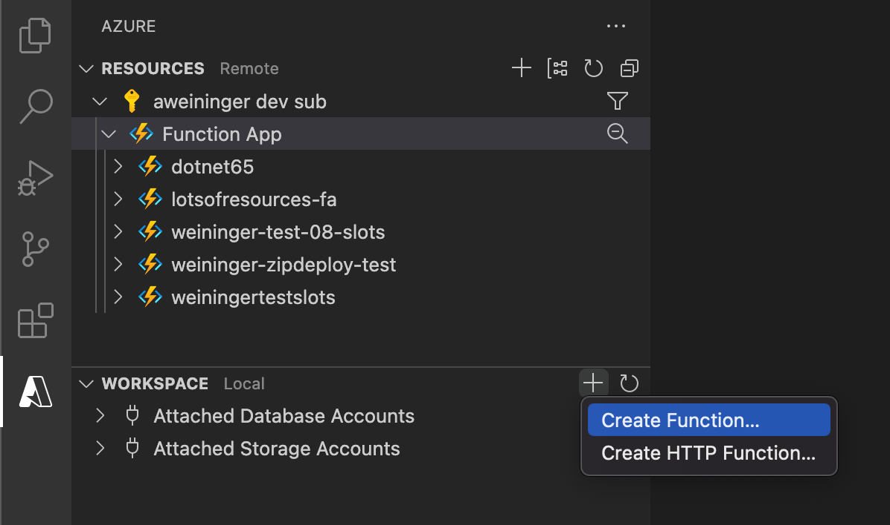
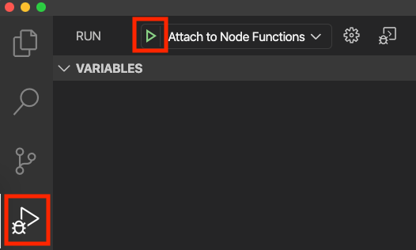
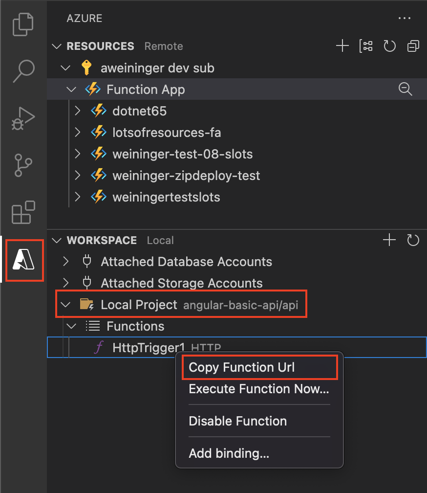
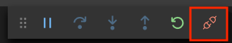
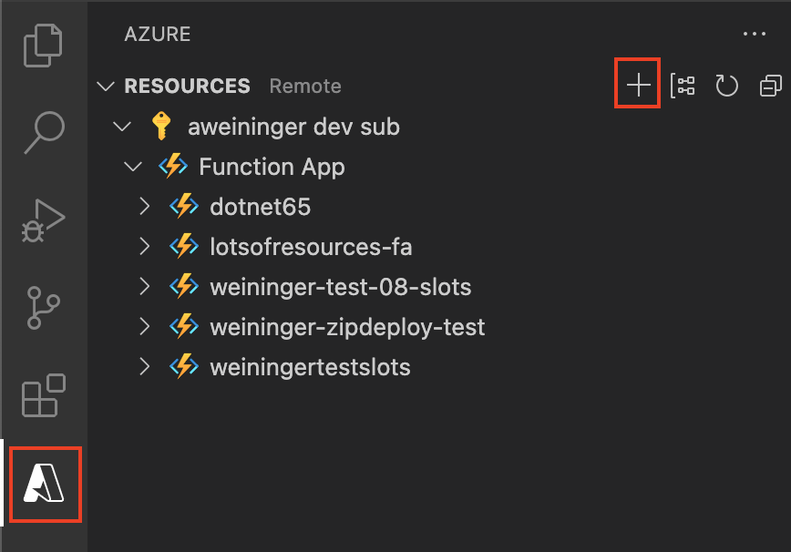
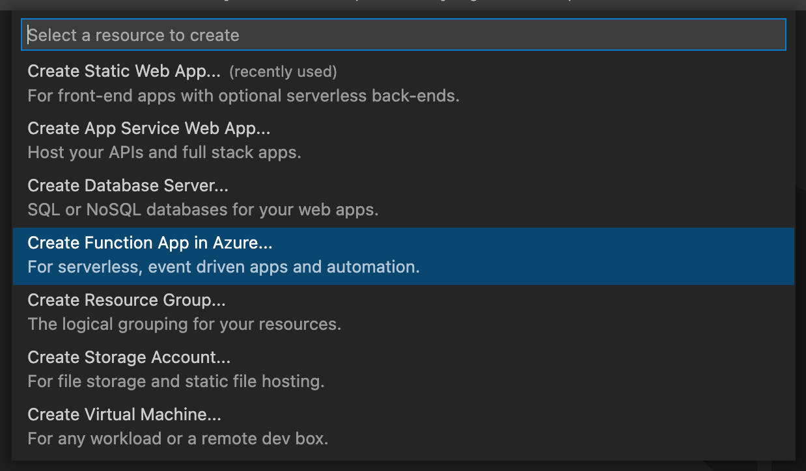
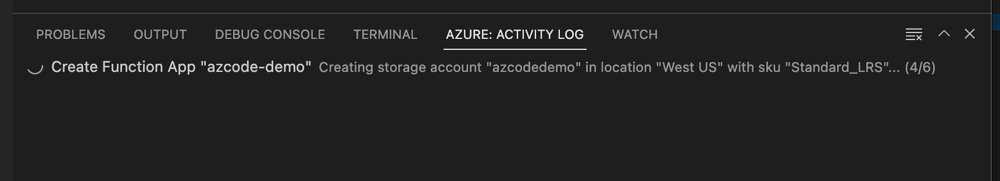
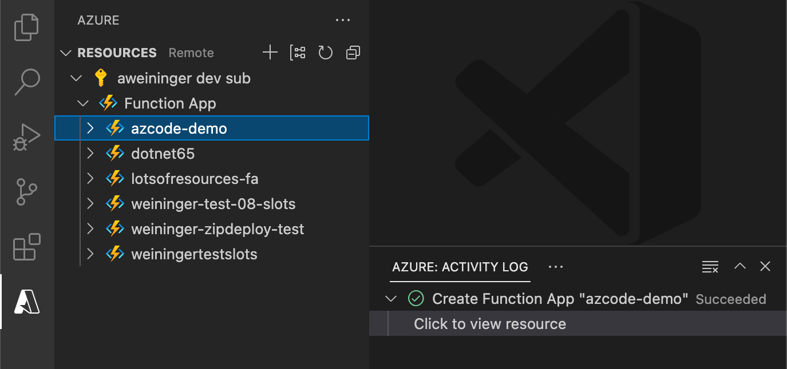
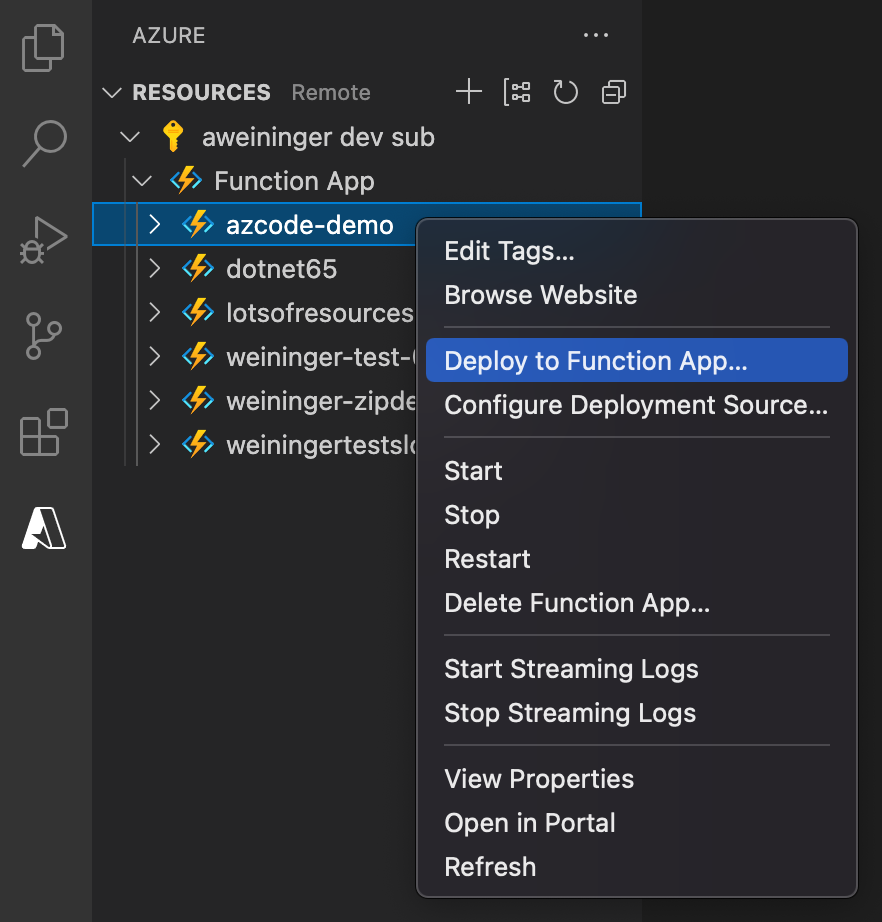
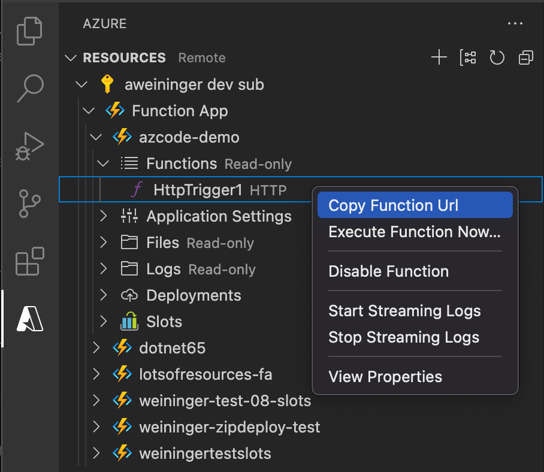

# Azure Functions for Visual Studio Code

<!-- region exclude-from-marketplace -->

[](https://dev.azure.com/devdiv/DevDiv/_build/latest?definitionId=20565&repoName=microsoft%2Fvscode-azurefunctions&branchName=main)

<!-- endregion exclude-from-marketplace -->

Use the Azure Functions extension to quickly create, debug, manage, and deploy serverless apps directly from VS Code.

**Visit the [wiki](https://github.com/Microsoft/vscode-azurefunctions/wiki) for more information about Azure Functions and how to use the advanced features of this extension.**

> Sign up today for your free Azure account and receive 12 months of free popular services, $200 free credit and 25+ always free services 👉 [Start Free](https://azure.microsoft.com/free/open-source).

## Create your first serverless app

1. Select the button to create a new project in the Azure Resources explorer

    

1. Select a new, _empty_ folder to contain your project
1. Select your desired programming language
1. Select "HTTP trigger" for your project's first function
1. Use "HttpTrigger1" as the function name
1. Select "Anonymous" for the authorization level, which enables anyone to call your function endpoint without a key.
    > To learn more about authorization levels, see [here](https://docs.microsoft.com/azure/azure-functions/functions-bindings-http-webhook-trigger?tabs=csharp#authorization-keys).
1. If the selected folder is not already open, select "Open in current window" to open it

## Create Connector Trigger functions

In the classic **Create New Project** flow, choose **Connector Trigger** for a C#, TypeScript v4, or Python v2 project. In the authoring webview, choose an Azure subscription and supported region, select one connector, then select one or more polling events and choose **Create functions**.

Creation installs Node dependencies and builds TypeScript projects, restores and builds C# projects, or installs Python requirements into the virtual environment selected during VS Code initialization. If Python virtual-environment creation is skipped, a warning explains that dependencies still need to be installed; no packages are installed globally. Installation and build failures leave the generated files in place and the picker available for retry, rather than reporting completion.

Each selected event creates a separate function with its own trigger-configuration setting. Setting names use letters, digits, and underscores, with numeric suffixes to avoid collisions, while function names retain supported operation names. Local settings include the project's worker runtime, including `dotnet-isolated` for C# isolated projects. Events can share a Connector Namespace and connection. Non-deprecated webhook events remain visible, but cannot be created yet. JavaScript continues to use the existing filtered Template Gallery.

Project creation records every selected event in the project's `.vscode/settings.json` under `azureFunctions.connectorTriggerEvents`:

```json
{
    "azureFunctions.connectorTriggerEvents": [
        { "connectorId": "office365", "operationId": "OnNewEmailV3" },
        { "connectorId": "office365", "operationId": "OnFlaggedEmailV4" }
    ]
}
```

The selection can also include an `azureContext` containing the subscription ID, tenant ID, cloud, region, and, when available, account ID. These identifiers are saved in `.vscode/settings.json`, which may be tracked by source control. Credentials and parameter values are not saved in this selection. Retries update the record while preserving unrelated settings and JSONC comments. F5 uses a single saved event to preselect the connector and event in setup.

Events are loaded from the selected connector's regional exported definition (`managedApis/<connector>?api-version=2022-09-01-preview&export=true`). Swagger trigger and notification extensions distinguish polling events from webhooks; deprecated and internal events are excluded.

Authoring only creates local project files; it does not provision Azure resources, authorize connections, or collect event parameters. Before running or deploying, configure each binding's actual `connection` and `triggerConfigName` settings, including `<connection>__pollingEndpoint`. Multi-event F5 setup is deferred, and the sample templates' Azure provisioning hooks remain single-event examples rather than multi-event setup.

Use an empty destination folder. A retry with the same selection can complete a partial copy without overwriting existing files or local settings. VS Code initialization preserves customized launch configurations, tasks, settings, and JSONC comments while adding missing Functions entries and defaults without duplicates. Conflicting project files are reported before copying.

## Run the serverless app locally

This extension integrates with the [Azure Functions Core Tools](https://docs.microsoft.com/azure/azure-functions/functions-run-local) to let you run your project locally before publishing to Azure.

1. To start your project, press F5 or the "play" button

    

1. If you do not have the [Azure Functions Core Tools](https://aka.ms/Dqur4e) installed, you will be automatically prompted to install. Follow the specified instructions, or skip to the "Deploy" step if you would rather deploy without running locally.
    > TIP: The "Terminal" panel should pop up automatically and you know your project is running if you see output
1. Expand your _local project_ in the Azure Workspace explorer to copy your function's url

    

1. Navigate to a browser, paste the url, and append `?name=world`
    > TIP: Your url should look like this: `http://localhost:7071/api/HttpTrigger1?name=world`
1. A response of "Hello world" is returned in the browser and you know your function worked!
1. Select the "Detach" button to stop your project from running locally

    

### Configure a polling Connector Trigger

F5 discovers actual polling Connector Trigger bindings and their connection/Trigger Config setting keys. The project is the one containing the host task's working directory. Settings checks apply the current platform's `terminal.integrated.env` over the inherited environment, then the task's `options.env`; null terminal values remove inherited variables. If the host task runs outside a Functions project or its working directory cannot be resolved, Connector Trigger setup is skipped rather than configuring another project. Commented-out registrations and malformed `function.json` files elsewhere in the workspace are ignored. Projects whose effective settings are already configured skip setup, even without saved event metadata. Automatic setup supports one polling event per project; projects with multiple polling events and incomplete settings receive an actionable diagnostic instead of silently configuring the first event.

A newly created single-event project uses its `azureFunctions.connectorTriggerEvents` entry to preselect the authored connector and polling event. Choose **Configure**, then select the provisioning subscription and supported region. Projects without saved event metadata select the connector and event explicitly from the live API lists. Function registration names, `host.json`, and setting names are not used to guess canonical event IDs. Only the selected connector's event metadata is loaded; authoring does not authenticate a connection or load account-specific parameter choices.

Existing singular v1 entries in the folder's `azureFunctions.connectorTriggerProjects` setting remain supported, keyed by project-relative path (`"."` for the folder root), with only `version`, `connectorId`, and `operationId`. Invalid entries stop setup rather than guessing. User settings and shared `.code-workspace` settings do not supply project identities. F5 does not create an identity artifact or persist the selected subscription, region, connector/event association, parameters, or credentials in VS Code settings.

When F5 detects missing or invalid Connector Trigger runtime settings, a modal asks you to configure the trigger. Choose **Configure** to open setup, **Debug Anyway** to continue debugging without connector setup, or **Cancel** to stop debugging. The connector trigger still needs valid configuration to run; Debug Anyway does not save connector settings or dismiss the prompt on future runs. Projects with valid runtime settings skip this prompt.

The editable setup screen shows the connector/event, Azure scope, resource choices, and computed local-settings changes. Projects created from Connector templates save the authoring subscription and region in each event's optional `azureContext` in `azureFunctions.connectorTriggerEvents`. Account, tenant and cloud identifiers keep the default tied to the same Azure Resources context. Configure prepopulates these choices only when the matching authenticated subscription and supported region are still available; both remain editable, and setup still requires approval before provisioning. Older event settings without Azure context continue to require explicit scope selection.

The shared Subscription dropdown respects the Azure Resources subscription filter; choose **Show all subscriptions** or **Use filtered subscriptions** to switch lists, or type to search the current list. If the saved scope is unavailable or ambiguous, select a current subscription and region rather than using a guessed account or location. If no subscriptions are authenticated, choose **Sign in to Azure** from the dropdown. Select an existing or new Connector Namespace and connection; for new resources, edit the resource group, namespace, and connection names. Computed setting keys and value sources are read-only, existing values are hidden, and environment overrides are flagged.

Choose **Set up and authenticate** to approve provisioning and lock the resource choices. A progress banner and busy button appear immediately, with status updates during provisioning, browser authentication, parameter loading, and saving. Complete browser consent if needed. The same screen then unlocks the selected event's inputs from the connector API. Dynamic choices are loaded through that authenticated connection, not a local list. For folder pickers such as Outlook, use the arrow to browse children, select a folder, or go back to the previous folder. Changing a dependency clears and reloads its dependent choices.

Outlook address filters accept typed email addresses. Their built-in designer directory suggestions are not connector operations and do not require a separate Graph sign-in or lookup.

Failed dynamic lookups show an error instead of an empty choice list. Use **Reload choices** to retry before applying parameters.

Choose **Apply and continue** to send the selected IDs or paths, not their display labels, to the event's Trigger Config. Events with no inputs finish configuration after setup. Before approval, **Cancel setup** or closing the screen makes no connector changes. After approval, cancellation stops new work after any in-flight operation settles, keeps any resources already created, and does not apply unsubmitted parameter values. Cancel and restart debugging to change locked resource choices.

Setup writes the service-provided polling endpoint, Trigger Config reference, and approved local credential selection to `local.settings.json`, preserving unrelated settings, comments, and formatting. Unsaved/conflicting edits, encrypted settings, and conflicting environment overrides stop saving rather than overwriting them. Later F5 runs reuse valid runtime settings; cancelling parameter selection leaves existing Azure resources available for retry. Unsupported event metadata and unavailable required choices stop setup rather than substituting guessed values. Fix the connection access or event definition and retry F5.

For a new local developer configuration, setup runs in the existing DebugProvider predebug validation flow; it does not add a task. It requires preview extension bundle **4.50.0 or later**, including `Microsoft.Azure.Functions.Extensions.Connector` **1.0.0 or later**, Azure Identity with named-credential support, `Azure.Identity.Broker`, and the platform's native broker assets. Older bundles can contain broker libraries for other extensions while their Connector supports only webhooks; those libraries alone do not enable Poll delivery. F5 does not verify bundle or broker support before starting; if it is missing, the Functions host fails after launch. New script-language Connector projects set the supported bundle minimum automatically; the first F5 downloads the configured bundle if it is not cached, without clearing other cached versions. For existing projects, set the `host.json` extension bundle version range to `[4.50.0,5.0.0)` before retrying F5. Sign in through **Azure Resources / Microsoft Authentication** in the environment where the Functions host runs. The broker's account, tenant, and cloud must match the selected subscription before setup changes Azure resources or grants connection access. Explicit CLI and service-principal configurations are retained rather than silently replaced.

To run a new TypeScript Connector project, install **Node.js 24 or later**, Functions Core Tools v4, and Azurite, then use **Create New Project → New Create → Connectors**. Creation installs the compatible SDK dependencies, builds the selected functions, and includes Node.js types in `tsconfig.json`; neither generic nor specialized templates require manual package or runtime edits. Start debugging with F5, choose **Configure**, approve the resource/connection setup, and supply the event inputs. The existing emulator flow handles local host storage. For an RSS test, use a publicly reachable feed and publish a new item after setup; allow up to the connector's 30-minute polling interval and verify an invocation or breakpoint, not just host startup. Compiled .NET projects still need broker support in the host-side extension package, not just in their isolated worker.

This flow also writes `"AZURE_TOKEN_CREDENTIALS": "VisualStudioCodeCredential"` and the selected subscription's tenant as `<connection>__tenantId` to local settings, leaving the connection's `__credential` unset. The tenant pin supports guest accounts without rewriting Azure Resources' home-tenant authentication record or changing other connections' tenant settings. The credential selection affects **every default Azure credential chain in that Functions host process**, not just the Connector Trigger. It contains no token and does not require `az login`. Upload Local Settings excludes this local-only selection and its Connector tenant pin; deployed connectors retain their existing managed-identity settings. Office 365 mailbox consent and the developer's connection-level receive policy are separate authorizations.

An overriding `AzureWebJobs<connection>` or `ConnectionStrings` section, including connection-string environment prefixes, blocks VS Code identity setup before provisioning or access grants. This check covers local settings and the effective process, terminal, and task environment. Remove the conflicting section or retain an explicitly configured credential instead of selecting VS Code authentication.

## Deploy to Azure

1. Sign in to your Azure Account by clicking "Sign in to Azure..." in the Azure Resources explorer
    >  If you don't already have an Azure Account, click "Create a Free Azure Account"
1. Select the 'plus' button to open the "Create Resource" menu

    

1. Choose "Create Function App in Azure..."

    

1. Enter a globally unique name for your Function App
1. If multiple versions of your language's runtime are supported (i.e. Node.js 10 and Node.js 12), select your desired version (the latest is recommended)
1. Select a location
1. Wait for your Function App to be created. Progress will be shown in the Activity Log panel

    

1. Once your Function App has been created, reveal the resource in the Resources view.

    

1. Right click your Function App and select "Deploy to Function App"

    

1. Once deployment is complete, expand your _subscription_ in the Azure Resources explorer to copy your deployed function's url

    

1. Navigate to a browser, paste the url, and append `?name=world`
    > TIP: Your url should look like this: `https://<function app name>.azurewebsites.net/api/HttpTrigger1?name=world`
1. A response of "Hello world" is returned in the browser and you know your function worked!

## Troubleshooting

### "unable to get local issuer certificate" on a corporate network

If you're on a corporate network that performs HTTPS/SSL inspection (for example Zscaler, Netskope, Cisco Umbrella, or an internal certificate authority), Azure operations may fail with errors like `unable to get local issuer certificate` or `self-signed certificate in certificate chain`. This happens because the extension's Azure calls run in the Node.js extension host, which does not use the operating system certificate store by default.

To resolve it, point Node.js and VS Code at your corporate root CA (typically by setting `NODE_EXTRA_CA_CERTS`). See the [certificate troubleshooting guide in the Azure Resources extension README](https://github.com/microsoft/vscode-azureresourcegroups/blob/main/README.md#unable-to-get-local-issuer-certificate-on-a-corporate-network) for the full steps.

<!-- region exclude-from-marketplace -->

## Contributing

There are a couple of ways you can contribute to this repo:

* **Ideas, feature requests and bugs**: We are open to all ideas and we want to get rid of bugs! Use the Issues section to either report a new issue, provide your ideas or contribute to existing threads.
* **Documentation**: Found a typo or strangely worded sentences? Submit a PR!
* **Code**: Contribute bug fixes, features or design changes:
  * Clone the repository locally and open in VS Code.
  * Run "Extensions: Show Recommended Extensions" from the [command palette](https://code.visualstudio.com/docs/getstarted/userinterface#_command-palette) and install all extensions listed under "Workspace Recommendations"
  * Open the terminal (press <kbd>CTRL</kbd>+ <kbd>\`</kbd>) and run `npm install`.
  * To build, press <kbd>F1</kbd> and type in `Tasks: Run Build Task`.
  * Debug: press <kbd>F5</kbd> to start debugging the extension.

### Legal

Before we can accept your pull request you will need to sign a **Contribution License Agreement**. All you need to do is to submit a pull request, then the PR will get appropriately labelled (e.g. `cla-required`, `cla-norequired`, `cla-signed`, `cla-already-signed`). If you already signed the agreement we will continue with reviewing the PR, otherwise system will tell you how you can sign the CLA. Once you sign the CLA all future PR's will be labeled as `cla-signed`.

### Code of Conduct

This project has adopted the [Microsoft Open Source Code of Conduct](https://opensource.microsoft.com/codeofconduct/). For more information see the [Code of Conduct FAQ](https://opensource.microsoft.com/codeofconduct/faq/) or contact [opencode@microsoft.com](mailto:opencode@microsoft.com) with any additional questions or comments.

<!-- endregion exclude-from-marketplace -->

## Telemetry

VS Code collects usage data and sends it to Microsoft to help improve our products and services. Read our [privacy statement](https://go.microsoft.com/fwlink/?LinkID=521839) to learn more. If you don’t wish to send usage data to Microsoft, you can set the `telemetry.enableTelemetry` setting to `false`. Learn more in our [FAQ](https://code.visualstudio.com/docs/supporting/faq#_how-to-disable-telemetry-reporting).

## Lifecycle

The Azure Functions extension for VS Code follows the [Modern Lifecycle Policy](https://docs.microsoft.com/lifecycle/policies/modern). Follow instructions [here](https://code.visualstudio.com/docs/editor/extension-gallery) to get the latest updates of the extension.

### Support Dates
|Version|Start Date|Retirement Date|
|---|---|---|
|1.x|10/20/2020|In Support|

## License

[MIT](LICENSE.md)
