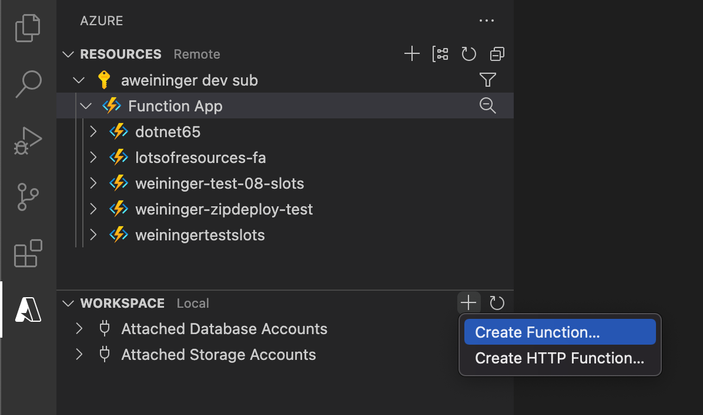
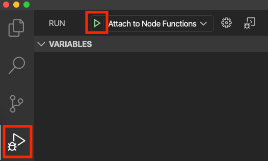
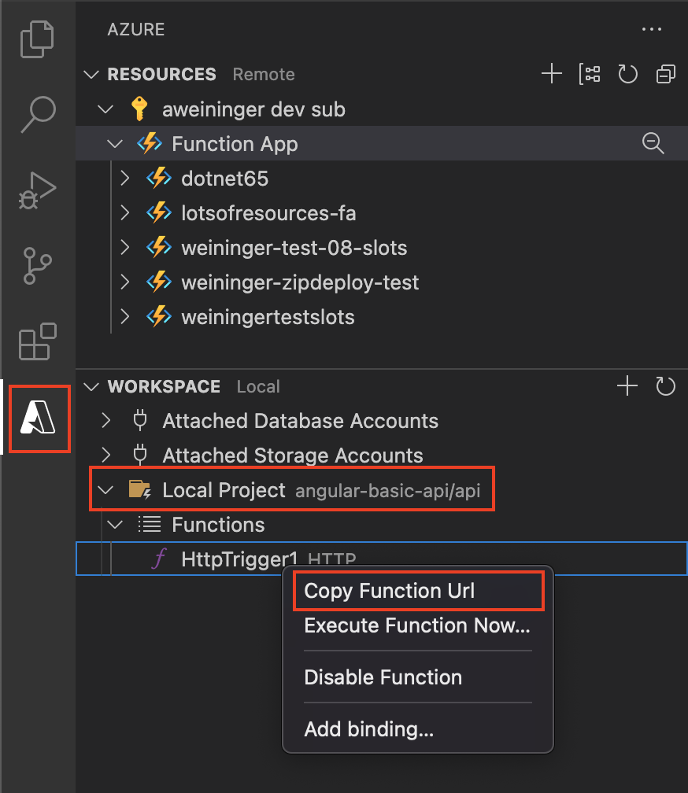
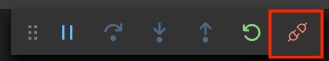
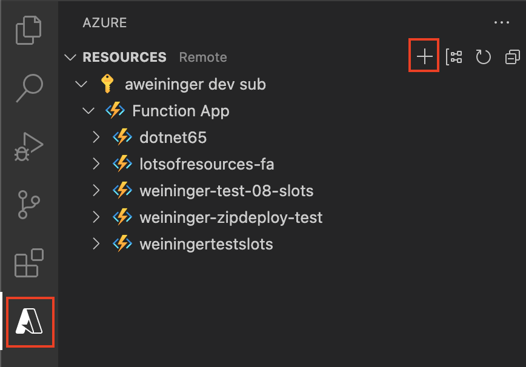
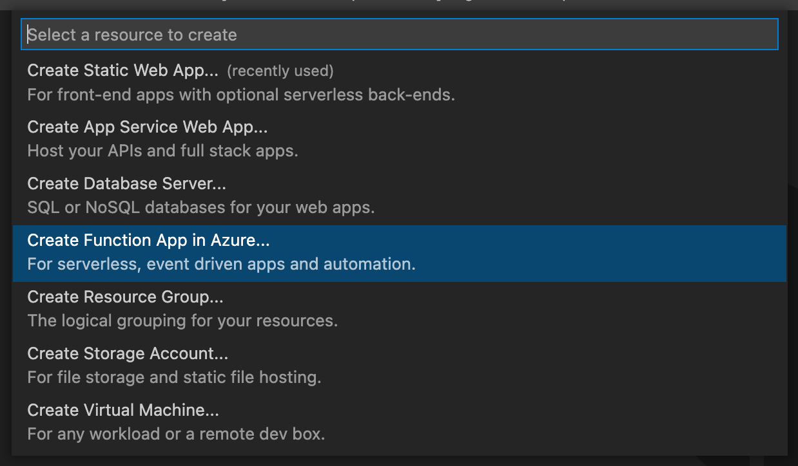
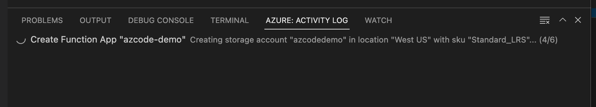
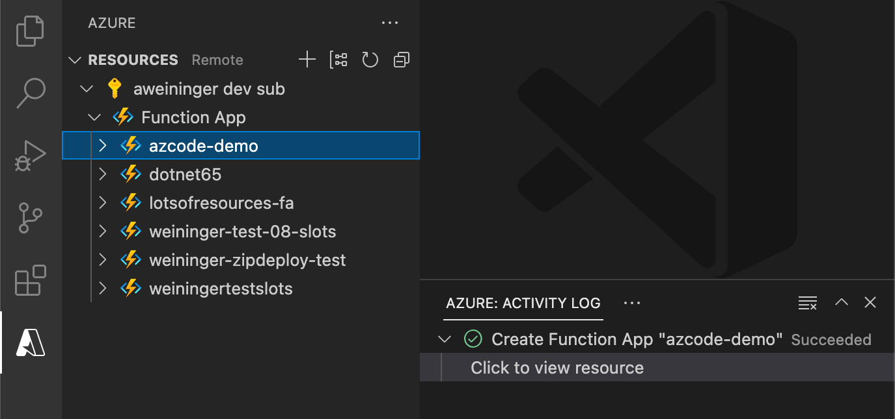
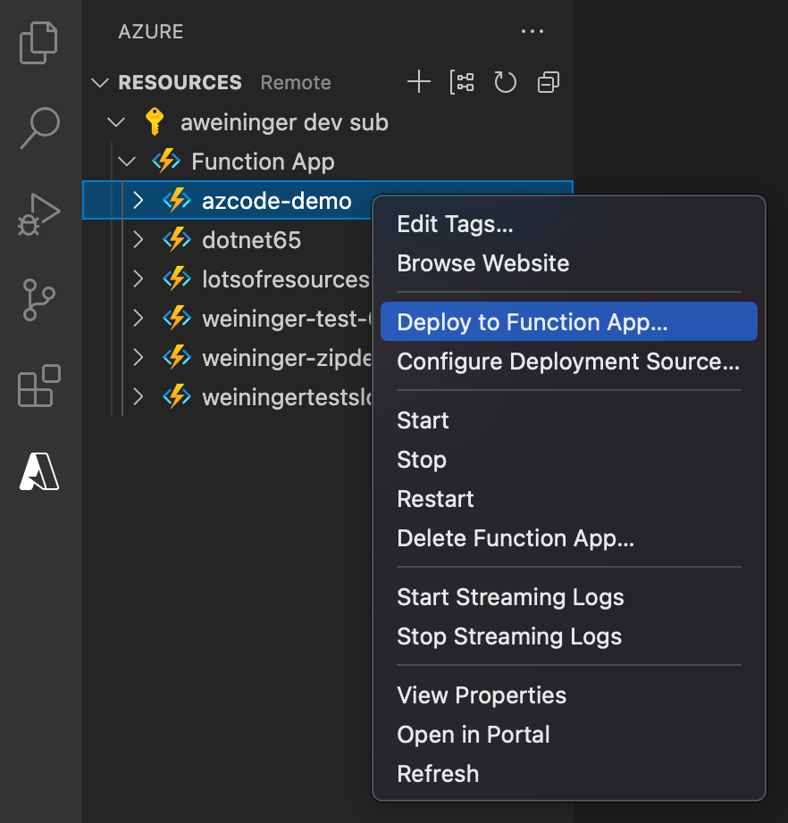
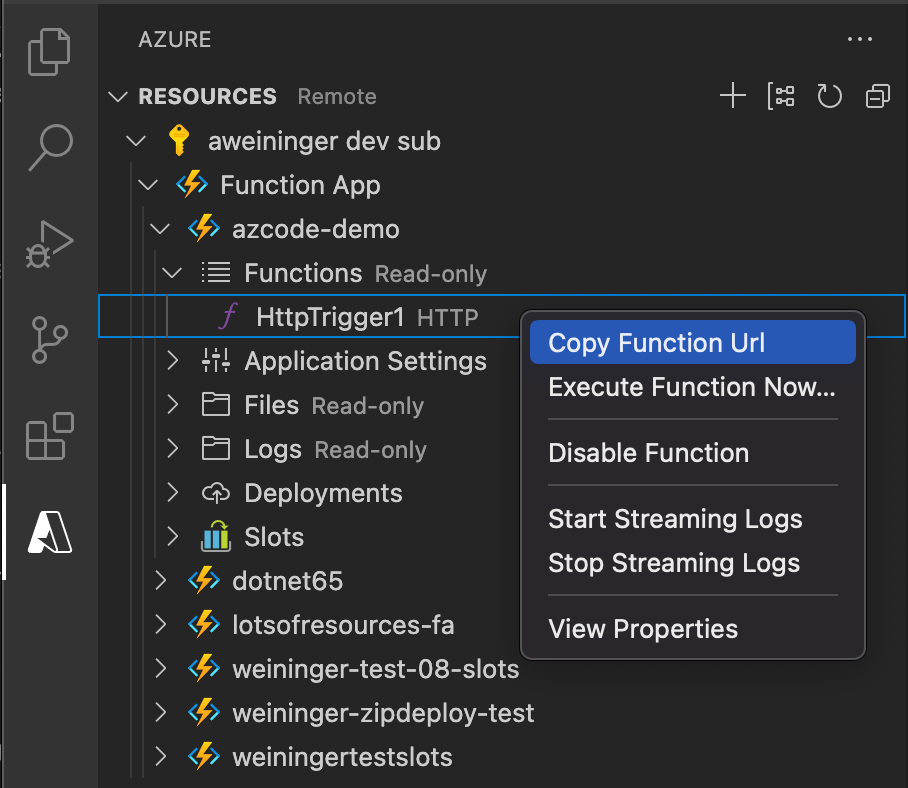

# Azure Functions for Visual Studio Code

<!-- region exclude-from-marketplace -->

[](https://dev.azure.com/devdiv/DevDiv/_build/latest?definitionId=20565&repoName=microsoft%2Fvscode-azurefunctions&branchName=main)

<!-- endregion exclude-from-marketplace -->

Use the Azure Functions extension to quickly create, debug, manage, and deploy serverless apps directly from VS Code.

**Visit the [wiki](https://github.com/Microsoft/vscode-azurefunctions/wiki) for more information about Azure Functions and how to use the advanced features of this extension.**

> Sign up today for your free Azure account and receive 12 months of free popular services, $200 free credit and 25+ always free services 👉 [Start Free](https://azure.microsoft.com/free/open-source).

## Create your first serverless app

1. Select the button to create a new project in the Azure Resources explorer

    

1. Select a new, _empty_ folder to contain your project
1. Select your desired programming language
1. Select "HTTP trigger" for your project's first function
1. Use "HttpTrigger1" as the function name
1. Select "Anonymous" for the authorization level, which enables anyone to call your function endpoint without a key.
    > To learn more about authorization levels, see [here](https://docs.microsoft.com/azure/azure-functions/functions-bindings-http-webhook-trigger?tabs=csharp#authorization-keys).
1. If the selected folder is not already open, select "Open in current window" to open it

## Run the serverless app locally

This extension integrates with the [Azure Functions Core Tools](https://docs.microsoft.com/azure/azure-functions/functions-run-local) to let you run your project locally before publishing to Azure.

1. To start your project, press F5 or the "play" button

    

1. If you do not have the [Azure Functions Core Tools](https://aka.ms/Dqur4e) installed, you will be automatically prompted to install. Follow the specified instructions, or skip to the "Deploy" step if you would rather deploy without running locally.
    > TIP: The "Terminal" panel should pop up automatically and you know your project is running if you see output
1. Expand your _local project_ in the Azure Workspace explorer to copy your function's url

    

1. Navigate to a browser, paste the url, and append `?name=world`
    > TIP: Your url should look like this: `http://localhost:7071/api/HttpTrigger1?name=world`
1. A response of "Hello world" is returned in the browser and you know your function worked!
1. Select the "Detach" button to stop your project from running locally

    

## Azure Invoke

For implementation details, design decisions, validation commands, and unfinished work, see the [prototype handoff](AZURE_INVOKE_PROTOTYPE.md).

Open **Azure Invoke** in the Azure sidebar and select **+** to choose a Functions trigger. HTTP requests and manual Azure Blob Storage uploads to Azurite are supported.

The HTTP editor has a method selector, URL, query parameters, headers, and request body. Select **Send** to make a real request and inspect the response status, duration, headers, and body. JSON responses display with two-space indentation in the editor and collection previews, without changing their values or the underlying response. Non-JSON responses display unchanged. For Azure Functions endpoints that require a function key, add it as an `x-functions-key` header. Requests run in the extension host and support local and deployed endpoints.

Use the pencil beside the invocation name to rename it, then select **Save** to add or update its entry in the tree. Saved invocations can be closed and reopened with their request fields intact. Unsaved edits are discarded when a tab closes.

Saved invocations stay in memory for the current VS Code window. Nothing is cached on disk automatically. Use **Save Collection...** in the view toolbar to export the saved invocations to a JSON file, and **Open Collection...** to load one later. Opening a collection replaces the current collection and closes its request tabs after confirmation. Collection files include all request data, including credentials, so export requires an explicit warning confirmation. Keep these files private and out of source control.

Redirects are displayed without being followed, and request and response bodies are limited to 5 MB. Requests use the `azureFunctions.requestTimeout` setting.

### Link request outputs

Use **Dependencies** in a request editor to reuse selected response fields instead of copying IDs or tokens into later requests. For example:

1. Save a **Create account** request using `POST /accounts`.
2. Open **Get account**, select **Dependencies**, and add a response value named `accountId`. Choose **Create account** as its source and `/body/id` as the selector.
3. Set the GET URL to `http://localhost:7071/accounts/{{accountId}}`, then save it.
4. Select **Run chain** to execute POST followed by GET. Afterward, **Send** repeats only GET using the current POST result, without creating another account.

Bindings imply prerequisites. Search by request name in **Dependencies** to choose a source or add an order-only prerequisite. Only selected prerequisites remain listed. Pickers support arrow keys, Enter, and Escape. **Run chain** executes prerequisites in dependency order, once each, then the selected request. It can change data in every request it runs. Cancellation stops remaining work but cannot undo completed requests.

Selectors use JSON Pointer: `/body/id` selects a JSON body field, `/body/items/0/id` selects an array item, `/headers/location` selects a response header, and `/status` selects the status code. Header names are lowercase. Escape `/` as `~1` and `~` as `~0` within JSON property names.

Use `{{guid}}` for unique synthetic data in URL paths, query values, headers, or bodies:

```json
{
  "email": "invoke-{{guid}}@example.com",
  "password": "Invoke-{{guid}}-Aa1!"
}
```

Each request execution generates a fresh UUID, reused at every `{{guid}}` occurrence in that request. The saved body keeps its placeholders. Adapt test passwords to the application's actual validation rules; do not use generated test data as production credentials. The name `guid` is reserved.

To log in with the account just created, bind `accountEmail` to the create request's `/request/body/email` and `accountPassword` to `/request/body/password`, then use them in the login body. These selectors read the resolved JSON body actually sent, not the saved template or a response field. They require a current successful source result, just like response selectors. Use explicit source links across requests rather than repeating `{{guid}}`, which would generate a different value in a later request. Generated inputs stay in memory and are not exported.

Use `{{accountId}}` in URL paths, query values, headers, or the body. URL substitutions are encoded as values and cannot change the host or protocol. In JSON bodies, write quoted placeholders such as `{"id":"{{accountId}}"}`. An exact placeholder retains the selected JSON type, including numbers, booleans, objects, arrays, and null. Embedded placeholders inside longer strings remain text.

Missing fields, unavailable sources, cycles, and failed prerequisites stop the run instead of using empty or stale values. Only 2xx responses can supply dependency values. Save and rerun a changed source before reusing it. A newer upstream run also invalidates older dependent outputs. No arbitrary pre-request or post-response JavaScript is executed.

The collection review has the same dependency editor and **Run chain** preview. Keep required prerequisite cases selected before confirming. Response values stay in memory; exports contain selectors and placeholders, not captured results. HTTP collections with dependencies use format version 2; ordinary HTTP collections remain version 1. Collections containing Blob invocations use version 3. All three versions can be imported.

### Invoke a Blob trigger manually

Select **Add Invocation Manually... > Azure Blob Storage trigger** to configure a reusable upload fixture. Set the Azurite blob service URL and container, then use **Choose file...** to select a file of at most 5 MB. Its filename becomes the blob name if that field is empty. You can change the blob name and content type. The fixture captures the file's bytes, not a link to the original file. Choose the file again to refresh its contents.

This first version supports local Azurite using its default `devstoreaccount1` emulator account. The default URL is `http://127.0.0.1:10000/devstoreaccount1`; change the loopback host or port to match your emulator. Azure accounts and custom emulator credentials are not supported yet. The application and emulators must already be running, for example through your F5 configuration. Azure Invoke does not start them.

Select **Save** to keep the fixture in the session tree. **Upload blob** sends the selected file's captured contents, creating the container if needed. Uploading overwrites any existing blob with the configured name without another confirmation, including a blob changed by another writer. This behavior is noted beside the upload controls. Uploads are not retried automatically. Cancellation does not undo changes already accepted by storage.

The receipt reports uploaded bytes, duration, ETag, and last-modified time. It confirms only the storage upload, not whether the function ran or succeeded. Blob entries always show an upload icon and **Blob Trigger** in the tree, without a last-run time. Hover for the last upload attempt and status. They remain manual-only, excluded from HTTP prerequisites, and skipped when you ask Copilot to run tests or the collection. Exported collections include the full fixture content, so keep them private.

For breakpoint-assisted invocation, save the fixture and select **Upload with Copilot breakpoints** in the editor or its sparkle action in the tree. This action authorizes one upload of the captured saved fixture after breakpoint setup. It uses the same Microsoft DebugMCP setup as HTTP debugging and requires an existing VS Code debug session. Copilot reads target metadata without the fixture content, inspects source, sets useful unconditional breakpoints, then calls the upload tool without a separate chat confirmation question. Your client may still show its normal tool-approval UI. Unsaved edits are ignored; changing the saved fixture, active debugger, or collection requires renewed authorization.

An optional **Breakpoint guidance** prompt lets you describe where Copilot should set breakpoints, for example where CSV rows are validated. Leave it blank to let Copilot choose. The description is shared for that upload only, is not saved in the fixture or collection export, and is not another approval question. Do not include secrets.

If the captured target does not match the discovered trigger binding, Copilot warns that the breakpoint may not hit but preserves the authorized fixture and proceeds without another permission question. It does not silently correct the target.

Inspect the breakpoint and resume execution yourself. Copilot does not step, continue, evaluate expressions, inspect variable values, reset state, or infer function success from an upload receipt. If DebugMCP or authorization is unavailable, it reports the blocker instead of uploading through another path. There is no automatic function-result observation or polling in this version.

### Create invocations with AI

Azure Invoke offers **Add Invocation Manually...** for individual requests and **Author Collection with AI...** for guided collection building. The AI entry point opens Copilot Chat with the extension's **Azure Invoke** custom agent.

The agent can also edit project source, tests, configuration, and related documentation while you develop and test. Ask it to investigate and fix application issues in the same chat; fixes are not limited to invocation definitions. Diagnosis and breakpoint actions remain read-only by default unless you request code changes. Code-editing support does not bypass collection review, execution approval, or captured-replay authorization.

The review opens with a loading indicator while the agent scans the workspace. It lists one generic template per discovered HTTP method and route and manual fixtures for Blob triggers, grouped by resource. Each row's description shows its trigger type alongside any manual-only, unsupported, or execution status. Supported entries start checked and collapsed. Extra HTTP scenarios are only proposed when requested. Other trigger types remain unsupported and cannot be selected.

For Blob fixtures, the agent inspects source bindings and non-secret emulator configuration to propose the actual container, blob destination, content type, and Azurite endpoint, including its port. It opens the native file picker through MCP so you can choose a file privately. You can also select **Choose file...** in the Blob row and edit the proposed destination. A blank blob name uses the selected filename. Confirm requires a file for every checked Blob fixture; uncheck a fixture to continue without one. Authoring and confirmation never upload blobs. The [manual Blob workflow](#invoke-a-blob-trigger-manually) describes captured files, overwrite behavior, and later uploads.

Expand a row to see the method, endpoint, authentication requirements, headers, query parameters, and body. A lock indicates required authentication, an open lock indicates anonymous access, and a question mark means authentication could not be determined. The agent fills body fields with valid synthetic values and uses generators and dependencies where needed. Optional query values remain empty and disabled unless requested. Required inputs that cannot be inferred safely need your input. Edit values, enable entries, and select **Send** or **Run chain** to try requests directly in the review. Previews use the same timeout, cancellation, and response limits as the request editor. They make real HTTP requests but do not save collection entries.

GET drafts include query names discovered in handlers, query models, validation, and parsing helpers, including filters, pagination, and sorting for list endpoints. Instance routes include their required path IDs, linked to a matching create operation when possible.

After a failed preview, select **Diagnose with Copilot** beside that request, or **Diagnose failed requests** for all current failures. Copilot compares the original drafts, failure evidence, and application source to distinguish request-configuration problems, likely application bugs, environment or authentication blockers, and uncertain causes. Diagnosis does not change drafts, edit application code, save requests, or rerun them. For a request correction, enter feedback and select **Request changes**. Application-code investigation is a separate request.

Choosing diagnosis explicitly shares the selected failure evidence with Copilot. Localhost responses may contain sensitive data. Bodies are limited to 64 KB per failure and 512 KB total, with truncation marked. Remote requests and chains containing non-local prerequisites share status and timing only. Private request edits are not shared directly, but a server response may echo them. Editing a request or its prerequisites requires a new preview before diagnosis.

Keep the templates you want checked. Entering feedback in any supported row, including an unchecked row, changes **Confirm** to **Request changes**. Select it to ask Copilot to apply the feedback and refresh the same review without saving or executing anything. Revisions preserve selections, manual field edits, and chosen files, and clear processed feedback. Manual field values, selected filenames, file paths, and file contents are not returned to AI. For Blob fixtures, it sees only whether a file was selected.

With no feedback, select **Confirm** to save the checked requests and captured Blob fixtures directly in the tree. Confirmation is disabled during previews or file selection, and all required HTTP prerequisites must remain selected. Existing collection entries are preserved. Confirm does not launch another chat turn, send HTTP, or upload blobs.

Confirmed requests keep their review groups as collapsible folders in the tree, such as Posts or Accounts. Requests without a group stay at the root. Collection files preserve the optional `group` on each invocation.

AI-created requests are added without opening individual tabs. Ask Copilot to run saved requests whenever you are ready. It can discover their IDs and execute their prerequisite chains without recreating them. AI execution still requires approval and can change data in every prerequisite. HTTP tree descriptions show **HTTP Trigger**, followed by the local last-run time in parentheses when available. HTTP icons distinguish requests that have not run, running requests, successful 2xx responses, failures, and cancellation. Hover to see the full last-run date and time, status, and duration; the review also shows execution progress. Editing a request preserves its last-run indicator. Open a request from the tree to inspect or edit it and see its last full response. Collection reviews, results, and saved requests are session-only. Use **Save Collection...** to export definitions explicitly; results, last-run timestamps, resolved inputs, and review comments are not exported.

Previous Copilot chat messages may remain visible after the session ends, but they do not restore a collection. The Azure Invoke agent is instructed not to offer restoration or recreate collections from chat history unless you explicitly ask. Recreating a previous collection requires a new review and confirmation.

### Inspect and fix saved requests with Copilot

Ask the Azure Invoke agent to "check the saved tests and propose fixes for request-configuration problems." It can read the same last-run statuses shown in the tree, including requests that have not run, without sending them again. With approval, it can inspect available last-run response evidence and compare it with application source.

Requests prevented from running by an unsuccessful prerequisite show a warning icon and a `blocked` status, not a failure icon. The prerequisite that actually failed retains its failure icon. Resolve that prerequisite before rerunning the blocked requests.

Request body values, header values, and query values stay private. Local response bodies can echo sensitive data; inspection shares at most 64 KB per response and marks truncation. Remote responses and chains with non-local prerequisites share status and timing only. An older result is identified when it no longer matches the saved request.

Copilot proposes only the request fields that need replacement. Review them in **Review saved request changes**, edit or uncheck entries, then select **Apply request changes** or **Cancel**. Prerequisites are included for context. Applying preserves saved IDs, names, groups, and omitted fields, and does not send requests or change application code. A saved request changed while the review is open blocks application rather than overwriting the newer edit. Existing request tabs keep their fields; close and reopen a tab to load an updated saved request.

Ask Copilot to rerun after applying changes. Execution still requires approval, including any mutating prerequisites. Application bugs, authentication/setup blockers, and uncertain causes should be explained rather than hidden by weakening requests. This saved-request flow does not automatically validate newly authored drafts.

### Debug a response with Copilot

This prototype requires [Microsoft DebugMCP](https://github.com/microsoft/DebugMCP), configured for **GitHub Copilot** in VS Code Chat, and an already running VS Code debug session for your local application. Starting and matching debug sessions automatically is not implemented yet; select the intended session before using this action.

Open a saved invocation, send it, then select **Debug with Copilot** below the response. The same Azure Invoke agent reads the shared last-run evidence, inspects application source, and uses DebugMCP to add a few useful unconditional breakpoints. It then requests approval to replay only the captured request with the same method, resolved URL, query parameters, enabled headers, and body. Generated values, credentials, tokens, and dependency-bound IDs are reused privately. Later saved or unsaved edits and newer prerequisite outputs are ignored. Prerequisites are not rerun and credentials are not refreshed. A request-configuration problem should produce a suggested correction instead of automatic edits or replay.

Replay does not reset application state or guarantee the previous response. For example, repeating a successful account registration with the same captured email may return 409. Use a normal run to generate fresh values and execute the dependency chain again.

Only localhost requests with local prerequisites are supported. The action explicitly shares the response with Copilot; bodies can contain sensitive data or echo private request values. Private request headers, query values, and body values are not shared directly. Application code and saved definitions remain unchanged. Copilot is instructed not to inspect variables, evaluate expressions, step, or resume execution. Inspect values and resume manually in VS Code.

Debug replays have no HTTP timeout so a breakpoint pause does not cause a misleading timeout. Cancel through chat or the request editor when needed. Ending the selected debug session also cancels the HTTP request. Ordinary requests keep the configured timeout. Authorization is single-use and bound to the captured execution and existing debug session. A new execution, changed active debugger, or replaced collection invalidates it. If authorization or the snapshot is unavailable, select **Debug with Copilot** again; replay never falls back to a normal run. Debug results remain visible but are not cached as sources for linked requests; use a normal run to refresh those dependencies.

The in-process MCP server is named **Azure Functions Extension Tools**. Enable its tools in your chat client's tool picker if they are unavailable. Its tools are:

| Tool | Purpose |
| --- | --- |
| `propose_invocation_collection` | Propose HTTP requests and manual Blob metadata in the review, without saving or executing them. |
| `select_blob_invocation_file` | Open the native picker for a Blob draft and capture its file privately. Returns no contents or paths and never saves or uploads. |
| `get_invocation_collection_review` | Read submitted feedback or confirmed HTTP and Blob selections and saved IDs. Edited values and selected files remain private. |
| `get_invocation_diagnostics` | Read only the failed previews explicitly shared through the active review's diagnosis actions, without running or changing requests. |
| `get_http_invocation_debug_context` | Read explicitly shared last-run evidence for a saved local request and its existing debug session. |
| `debug_http_invocation` | Replay that captured local request once after breakpoint setup and approval, without rerunning prerequisites. |
| `draft_http_invocation` | Revise an approved saved case, resolving prerequisite IDs without duplication. |
| `create_http_invocation` | Create an individual API request with optional bindings and prerequisites directly in the session tree. |
| `list_http_invocations` | Discover saved IDs, groups, methods, prerequisite IDs, and last-run statuses and timestamps without exposing request values. |
| `get_http_invocation_inspection` | Inspect saved request metadata and available last-run evidence with approval, without rerunning it or returning private request values. |
| `propose_http_invocation_changes` | Open a review of selected saved-request field replacements. Only Apply request changes updates the existing entries. |
| `run_http_invocation` | Run a saved request and its prerequisite chain without opening tabs. Set `runDependencies: false` to reuse current successful prerequisite results instead. |
| `list_blob_invocations` | Discover manual-only Blob fixtures without returning their content. These are excluded from HTTP runs. |
| `get_blob_invocation_debug_context` | Read metadata shared by the editor or tree's breakpoint-assisted upload action. |
| `upload_blob_invocation` | Upload an explicitly requested saved Blob fixture with approval, optionally bound to breakpoint-flow authorization. Returns storage metadata, not function results. |

AI-generated names are limited to 60 characters. Individual creation accepts a name and URL, plus an optional method, headers, query parameters, and raw body. Running uses the saved request, not unsaved editor changes. It can change server-side data, so the tool requests approval for every call. Requests share the editor's timeout, cancellation, body limits, and no-retry/no-redirect behavior. Stop the chat request to cancel a headless run, or open its editor and select **Cancel**.

AI receives final status and duration for every response. For `localhost`, IPv4 loopback addresses (`127.0.0.0/8`), and IPv6 loopback (`::1`), it also receives the full final response body up to the existing 5 MB limit and selected non-sensitive headers. Other endpoints return no body or headers to AI. A chain with any non-local prerequisite returns only status and timing, including when its final endpoint is localhost, so linked values cannot bypass that restriction. Local bodies may contain sensitive data; response headers such as authorization, cookies, and custom credential headers are not shared.

## Deploy to Azure

1. Sign in to your Azure Account by clicking "Sign in to Azure..." in the Azure Resources explorer
    >  If you don't already have an Azure Account, click "Create a Free Azure Account"
1. Select the 'plus' button to open the "Create Resource" menu

    

1. Choose "Create Function App in Azure..."

    

1. Enter a globally unique name for your Function App
1. If multiple versions of your language's runtime are supported (i.e. Node.js 10 and Node.js 12), select your desired version (the latest is recommended)
1. Select a location
1. Wait for your Function App to be created. Progress will be shown in the Activity Log panel

    

1. Once your Function App has been created, reveal the resource in the Resources view.

    

1. Right click your Function App and select "Deploy to Function App"

    

1. Once deployment is complete, expand your _subscription_ in the Azure Resources explorer to copy your deployed function's url

    

1. Navigate to a browser, paste the url, and append `?name=world`
    > TIP: Your url should look like this: `https://<function app name>.azurewebsites.net/api/HttpTrigger1?name=world`
1. A response of "Hello world" is returned in the browser and you know your function worked!

## Troubleshooting

### "unable to get local issuer certificate" on a corporate network

If you're on a corporate network that performs HTTPS/SSL inspection (for example Zscaler, Netskope, Cisco Umbrella, or an internal certificate authority), Azure operations may fail with errors like `unable to get local issuer certificate` or `self-signed certificate in certificate chain`. This happens because the extension's Azure calls run in the Node.js extension host, which does not use the operating system certificate store by default.

To resolve it, point Node.js and VS Code at your corporate root CA (typically by setting `NODE_EXTRA_CA_CERTS`). See the [certificate troubleshooting guide in the Azure Resources extension README](https://github.com/microsoft/vscode-azureresourcegroups/blob/main/README.md#unable-to-get-local-issuer-certificate-on-a-corporate-network) for the full steps.

<!-- region exclude-from-marketplace -->

## Contributing

There are a couple of ways you can contribute to this repo:

* **Ideas, feature requests and bugs**: We are open to all ideas and we want to get rid of bugs! Use the Issues section to either report a new issue, provide your ideas or contribute to existing threads.
* **Documentation**: Found a typo or strangely worded sentences? Submit a PR!
* **Code**: Contribute bug fixes, features or design changes:
  * Clone the repository locally and open in VS Code.
  * Run "Extensions: Show Recommended Extensions" from the [command palette](https://code.visualstudio.com/docs/getstarted/userinterface#_command-palette) and install all extensions listed under "Workspace Recommendations"
  * Open the terminal (press <kbd>CTRL</kbd>+ <kbd>\`</kbd>) and run `npm install`.
  * To build, press <kbd>F1</kbd> and type in `Tasks: Run Build Task`.
  * Debug: press <kbd>F5</kbd> to start debugging the extension.

### Legal

Before we can accept your pull request you will need to sign a **Contribution License Agreement**. All you need to do is to submit a pull request, then the PR will get appropriately labelled (e.g. `cla-required`, `cla-norequired`, `cla-signed`, `cla-already-signed`). If you already signed the agreement we will continue with reviewing the PR, otherwise system will tell you how you can sign the CLA. Once you sign the CLA all future PR's will be labeled as `cla-signed`.

### Code of Conduct

This project has adopted the [Microsoft Open Source Code of Conduct](https://opensource.microsoft.com/codeofconduct/). For more information see the [Code of Conduct FAQ](https://opensource.microsoft.com/codeofconduct/faq/) or contact [opencode@microsoft.com](mailto:opencode@microsoft.com) with any additional questions or comments.

<!-- endregion exclude-from-marketplace -->

## Telemetry

VS Code collects usage data and sends it to Microsoft to help improve our products and services. Read our [privacy statement](https://go.microsoft.com/fwlink/?LinkID=521839) to learn more. If you don’t wish to send usage data to Microsoft, you can set the `telemetry.enableTelemetry` setting to `false`. Learn more in our [FAQ](https://code.visualstudio.com/docs/supporting/faq#_how-to-disable-telemetry-reporting).

## Lifecycle

The Azure Functions extension for VS Code follows the [Modern Lifecycle Policy](https://docs.microsoft.com/lifecycle/policies/modern). Follow instructions [here](https://code.visualstudio.com/docs/editor/extension-gallery) to get the latest updates of the extension.

### Support Dates
|Version|Start Date|Retirement Date|
|---|---|---|
|1.x|10/20/2020|In Support|

## License

[MIT](LICENSE.md)
